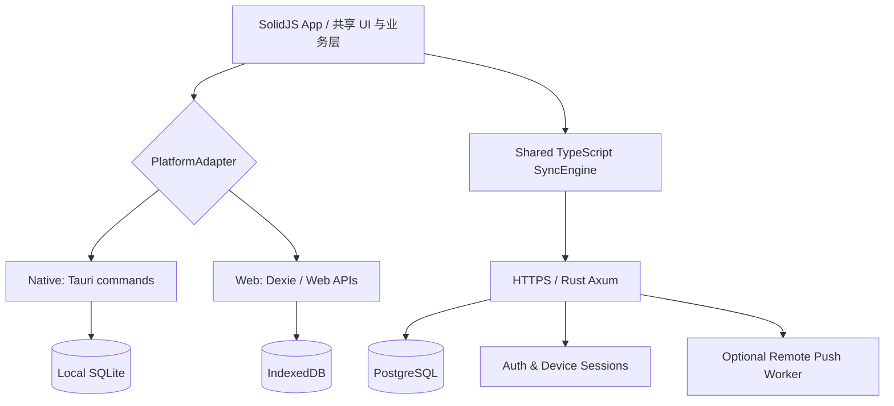

# 轻量跨平台 To Do：完整产品与技术设计 V1.0

> 状态：设计基线（2026-10-21）  
> 定位：本地优先、跨平台、可自托管的个人任务管理软件。  
> 发布目标：Windows / macOS / Linux / Android / iOS / Web。  
> 技术路线：SolidJS + TypeScript + Vite + Tauri 2 + SQLite + Rust(Axum) + PostgreSQL。

---

## 0. 决策摘要

1. **桌面端与移动端统一 Tauri 2 + SolidJS**。不额外启动 Node 服务、不捆绑 Electron 的 Chromium。五种原生平台共用 UI 和业务层，平台差异封装在适配器与少量原生插件中。
2. **Web 端使用相同 SolidJS SPA，配置为 PWA**；本地数据改用 IndexedDB + Dexie。首期不做 SSR，待办应用没有 SEO 诉求。
3. **本地先写、异步同步**。Native SQLite/Web IndexedDB 是交互读写入口，云端 PostgreSQL 承担账号级持久化及跨设备同步。
4. **只做单用户私有清单**。V1 不做协同共享、企业多租户、复杂项目管理、附件和 AI Agent。
5. **采用可验证的操作日志同步，不在首版引入 CRDT**。以字段级补丁、服务端账号内串行序列、幂等重试、墓碑和客户端重放解决最常见离线冲突。
6. **提醒是独立基础能力**。原生系统通知由 Android/iOS/macOS/Windows/Linux 的平台适配层执行，不能把 WebView 中的 `setTimeout` 当后台提醒。
7. **先实现应用的纵向闭环再优化体积**。第一阶段就能从 UI 新建任务、写入 SQLite、重启恢复；第二阶段才接云同步，避免技术架构悬空。

### 为什么不用其他方案

| 路线                  | 优点                           | 代价及结论                                |
| --------------------- | ------------------------------ | ----------------------------------------- |
| Electron + React      | 成熟的桌面生态                 | 桌面资源成本偏高，移动端需另建；不选      |
| Flutter 全平台        | 移动原生体验强、成熟的绘制引擎 | 需要 Dart 生态，不复用 TS/TSX；备选       |
| React Native + Tauri  | 移动端原生能力成熟             | 两套视图体系和适配工作；不选              |
| Tauri 2 + React       | 组件生态丰富                   | 可行，团队生态优先时可替代 Solid          |
| **Tauri 2 + SolidJS** | TSX、轻量、五类原生壳复用      | 移动端原生提醒等需验证/补充插件；**首选** |

## 1. 产品定义

### 1.1 产品使命

用最短的操作路径收集任务、决定今天做什么、收到靠谱提醒、完成任务。它应是用户随手打开的小工具，而不是要花时间配置的项目管理平台。

### 1.2 设计原则

- **Capture first**：打开应用后，输入框可立即输入；回车创建；不强制填日期或清单。
- **Today is a view, not a container**：“我的一天”是某日选中的任务集合，任务的永久归属仍是原清单。
- **Offline by default**：使用功能无需先注册，离线期间允许新建/编辑/完成/删除。
- **One primary action**：每个任务行优先突出“完成”；其他操作收起。
- **Low cognitive load**：默认不显示标签、优先级矩阵、看板等复杂概念。
- **Platform-aware**：共享设计系统，但桌面/移动允许不同信息架构与手势。
- **Honest sync state**：本地已保存、云端同步中、同步出错需明确区分。

### 1.3 用户故事

1. 我在 PC 用快捷键打开快速录入，输入“周五提交报销”，回车后马上看到任务。
2. 地铁无网时修改截止日期、完成任务；连网后这些变化被同步到手机。
3. 我每天打开“我的一天”，只挑 3～5 个值得完成的任务。
4. 我在手机上设置明天下午 3 点提醒，即使应用被挂起也尽可能收到系统提醒。
5. 我在 PC 改标题，同时手机改提醒时间，合并后应同时保留两项修改。
6. 换设备登录后自动获得所有清单与任务，也能随时导出 JSON/CSV。

### 1.4 范围

**MVP / V0.1**：收件箱、我的一天、计划内、重要、已完成、用户清单、任务详情、子步骤、备注、截止日期、搜索、本地 SQLite、响应式布局、导出备份。

**V0.2**：邮件登录、多设备、云同步、同步诊断、冲突回归、设备管理。

**V0.3**：系统本地提醒、重复规则、桌面全局快捷键、移动端快捷入口、移动原生打包、PWA 离线。

**V1.0**：五类原生平台 + Web 发布、跨平台完整回归、无障碍适配、稳定备份恢复与自托管说明。

**暂不做**：多人共享、日历双向同步、附件、富文本编辑器、评论、AI Agent、E2EE、WebSocket 常驻、复杂看板、企业组织权限。以上有真实需求再评估。

## 2. 平台、运行时与分层

### 2.1 部署矩阵

| 平台    | 壳                     | 本地数据  | 系统能力                               | 分发                             |
| ------- | ---------------------- | --------- | -------------------------------------- | -------------------------------- |
| Windows | Tauri 2 + WebView2     | SQLite    | 系统通知、托盘、全局快捷键             | NSIS/MSI；签名                   |
| macOS   | Tauri 2 + WKWebView    | SQLite    | 系统通知、Dock、快捷键                 | DMG / App Store；公证            |
| Linux   | Tauri 2 + WebKitGTK    | SQLite    | 桌面通知、托盘                         | deb / AppImage；桌面环境差异测试 |
| Android | Tauri 2 + 系统 WebView | SQLite    | 通知、启动器快捷入口、系统提醒桥接     | AAB/APK                          |
| iOS     | Tauri 2 + WKWebView    | SQLite    | 通知、Universal Link、App 生命周期     | TestFlight / App Store           |
| Web     | SolidJS PWA            | IndexedDB | Service Worker、浏览器通知（能力有限） | 静态 CDN + API                   |

注意：Native 端的安装包较小不代表进程内存天然小。实际运行时的系统 WebView 依旧占内存，需要真实设备压测。

### 2.2 架构



所有业务组件调用 `TaskService` / `TaskRepository` / `ReminderPort` / `SyncTransport` 接口，**禁止 UI 组件直接读取 SQL 或直接构造 HTTP 请求**。

### 2.3 四层边界

- `domain`：纯 TS 数据类型、校验、日期语义、重复任务规则、任务命令。
- `application`：用例服务 `CreateTask`、`CompleteTask`、`PlanMyDay`、`SyncNow`；不认识 Tauri。
- `infrastructure`：Tauri SQLite Repository、Dexie Repository、REST Transport、系统提醒适配器。
- `presentation`：Solid 组件、路由、交互状态、焦点管理、适配布局。

Rust 部分分两类：客户端薄桥接（SQLite、通知、系统能力）与服务端 Axum。服务端不会打包进客户端，也不需要本地 HTTP server。

## 3. 视觉与交互设计

### 3.1 整体风格

风格：克制、明亮、中性、适量强调色。参考 Microsoft To Do 的信息结构，但使用自己的 icon、间距与动态反馈，避免像素级照抄。

- 设计 token：4px 基础网格；桌面常规任务行 48～52px、移动任务行 56～64px。
- 浅色/深色主题；默认跟随系统；焦点边框与键盘可访问状态不可省略。
- 字体采用系统默认字体；不强制打包大型字体文件。
- 动效 120～200ms 且可关闭；不做大面积毛玻璃、重模糊、复杂投影。
- 图标采用 tree-shakeable Lucide，确保只打包实际使用图标。

### 3.2 PC 端三栏

```text
┌──────────────────┬─────────────────────────────────┬─────────────────────────┐
│  搜索任务   ⌕     │  我的一天           今天，周三   │  任务详情               │
│                  │                                 │                         │
│  ☀ 我的一天       │  ○  完成代码 Review             │  完成代码 Review         │
│  ☆ 重要           │  ○  处理报销                     │  ★ 标记重要              │
│  ◷ 计划内         │  ●  修复同步问题                 │  + 添加子步骤            │
│  ▤ 全部任务       │                                 │  日期 / 提醒 / 重复       │
│                  │  + 添加任务                      │  备注                    │
│  ── 我的清单 ──   │                                 │                         │
│  工作             │                                 │                         │
│  生活             │                                 │                         │
│  + 新建清单       │                                 │                         │
└──────────────────┴─────────────────────────────────┴─────────────────────────┘
```

- 详情栏仅在选中任务时出现，可折叠；列表保持滚动位置。
- `Ctrl/Cmd + K` 打开任务搜索，`Ctrl/Cmd + N` 快速录入（具体与系统冲突时重映射）。
- `Enter` 提交输入，`Escape` 退出编辑，`Space` 在任务行焦点下切换完成。
- 拖动排序为增强项，首期优先提供键盘“上移/下移”，不要只依赖拖拽。

### 3.3 移动端

```text
┌────────────────────────────┐
│ 我的一天          ⋮    ☀   │
│ 10 月 21 日，周三           │
│                            │
│ ○ 完成代码 Review          │
│ ○ 处理报销                 │
│ ○ 修复同步问题             │
│                            │
│                            │
│ + 添加任务                 │
├────────────────────────────┤
│  今天    全部    清单   我   │
└────────────────────────────┘
```

- 底部导航 4 项；任务详情使用全屏页面或 Sheet，而不是强塞桌面侧栏。
- 底部输入框随软键盘上推，尊重安全区 `safe-area-inset-bottom`。
- 左右滑动操作必须可撤销；侧滑删除不直接永久删除。
- 点击目标 >=44×44 CSS px；长按拖动仅作为可选快捷手势。
- 平板：双栏自适应，详情可独立展示。

### 3.4 页面和组件

| 页面     | 核心组件                                   | 行为                         |
| -------- | ------------------------------------------ | ---------------------------- |
| 我的一天 | DateHeading / TodaySuggestions / TaskList  | 跨清单选取今日任务           |
| 全部任务 | TaskList / Sort / Filters                  | 按状态、日期筛选             |
| 计划内   | PlannedGroup                               | 逾期、今天、未来日期分组     |
| 重要     | ImportantList                              | 星标任务跨清单汇总           |
| 清单     | ListHeader / TaskComposer / TaskList       | 创建、重命名、调整顺序       |
| 任务详情 | StepEditor / DueDate / Reminder / Notes    | 更新、删除、恢复             |
| 搜索     | SearchDialog                               | 本地索引模糊匹配             |
| 设置     | Appearance / Sync / ImportExport / Devices | 同步诊断、退出登录、管理数据 |

使用 Kobalte 作为必要的无样式可访问性基础组件；简单 Button / TaskRow 自研，避免引入整套重量级组件库。任务列表超 300～500 行再开启 TanStack Virtual，默认列表不用一上来就虚拟化。

## 4. 业务模型与规则

### 4.1 核心实体

- `List`：清单，包含 Inbox 虚拟归属，用户可有自定义清单；智能列表并非真实清单。
- `Task`：主任务；`status`、`important`、`due_on`、`remind_at` 相互独立。
- `Step`：任务子步骤；一个步骤只能属于一个任务。
- `DayPlan`：`user_id + local_date + task_id`，表示当天主动选择的任务。
- `Reminder`：提醒设置与系统调度状态，后者是设备本地派生数据。
- `Recurrence`：重复规则；每次完成触发生成下一个实例。
- `Device`：同步身份、OS 类型、最后访问时间，允许单设备撤销。
- `Mutation`：操作日志；用于跨设备同步，非任务活动时间线。

### 4.2 时间语义必须严格区分

- `due_on`: 日期 `YYYY-MM-DD`，表示截止日，**没有时分秒**。
- `remind_at`: 绝对 UTC instant，表示某时触发提醒。
- `remind_timezone`: IANA 时区，例如 `Asia/Shanghai`，保留用户创建提醒时的本地语义。
- `my_day_date`: 按账户首选时区计算的日历日期，与 UTC 日期无关。
- `completed_at`: UTC instant，用于排序、历史和多设备一致性。
- 重复任务的“每天 09:00”根据时区与日历规则计算，不能简单 `+86400s`。

**“我的一天”隔日刷新方式**：当天任务计划保持历史记录；UI 只按当天日期查询。跨过当地午夜后自然显示新的空计划，未完成任务保留原清单，可以进入次日建议，不需要后台批量删除或移动任务。

### 4.3 重复任务

V0.3 首期只允许：每天、工作日、每周指定星期、每月指定日、每年。使用有限规则 JSON，而不是直接暴露完整 RFC 5545 表达式。

完成当前实例后，在事务里：

1. 幂等标记当前实例为完成；
2. 根据 recurrence 规则计算下一次 `due_on`；
3. 创建 `series_id` 相同、`occurrence_key` 不同的新实例；
4. `UNIQUE(series_id, occurrence_key)` 避免网络重试产生双任务。

“完成后 N 天再重复”需和“日历上每 N 天”区分，作为单独 `anchor_mode`。时区或夏令时变化要覆盖测试。

## 5. 本地数据库架构

### 5.1 Native 端

- SQLite，`PRAGMA journal_mode=WAL`、`foreign_keys=ON`，必要时调 `busy_timeout`。
- Rust 端封装受控的 `TaskRepository` Commands；**不暴露任意 SQL 执行权限给 UI**。
- `rusqlite` + 专用阻塞执行线程/任务队列。禁止在 Tokio async executor 主线程直接执行耗时 SQLite 操作，也不持有线程不安全的 DB 连接跨异步边界。
- 单数据库实例采用事务串行写，读可复用单独连接；应用规模足以覆盖。
- 数据迁移携带 schema version，迁移前建立可靠备份；使用参数化查询。

Tauri 官方 SQL 插件也能在五类原生平台工作，但为了最小权限和固定领域命令，这里优先采用小型自定义桥接。若实测自定义桥接维护成本高，可退回官方 SQL 插件。

### 5.2 Web 端

- Dexie + IndexedDB；与 Native `TaskRepository` 对齐接口。
- Web 存储可能被浏览器清理；必须显式提示同步/导出。持久化授权可使用 `navigator.storage.persist()` 尝试申请，但不能假定获批。
- PWA 离线依赖 Service Worker 缓存前端资源，不缓存带认证的 API 响应。

### 5.3 可恢复状态模型（关键）

客户端包含三类数据：

1. **server shadow**：已确认的云端实体基线快照（仅登录后启用）。
2. **outbox**：未确认的本地 mutation，包含 `op_id`、`device_id`、`client_seq`、实体键、修改字段。
3. **materialized view**：应用 UI 查询的本地物化任务与清单表，代表 shadow + pending outbox 的重放结果。

每次本地操作必须在**同一本地事务**内更新物化视图与 outbox，确保 UI 可见后操作已持久化。同步时更新 shadow、确认 outbox，再重放剩余 outbox 到受影响实体的物化视图，避免拉取远端数据覆盖尚未同步的本地输入。

无账号时直接写物化表与 guest 本地操作历史；登录时走显式的“合并本地任务到云端”流程，不能悄悄覆盖账号已有数据。

### 5.4 搜索

- Native：SQLite FTS5 `trigram`，索引标题和备注；中文 ≥3 字的子串优先走 trigram，1～2 字中文搜索回退 `LIKE` 并限制最大结果数（必要时做 bigram 倒排表）；其他过滤（清单/状态/日期）使用 B-tree。
- Web：Dexie 本地搜索，任务量大时按规范化 token 建倒排表，不引入大型全文检索库。
- 输入 100～150ms 防抖，所有结果返回有限分页，组件绝不能扫描所有历史任务重新计算每个键击。

## 6. 云端 Rust 服务

### 6.1 技术选择

- Rust stable、Axum、Tokio、Serde、SQLx(PostgreSQL)、tracing。
- PostgreSQL 负责 users / devices / lists / tasks / steps / plans / mutations / reminder schedules。
- `utoipa` 产生 OpenAPI，客户端从 OpenAPI 生成 TS DTO；运行时入站值使用 Zod/Valibot 或简单显式校验。
- `tower-http` 支持 CORS、压缩、超时、请求追踪。
- 初期不引入 Redis、Kafka、Kubernetes、微服务。单 Axum 进程和单 Postgres 即可运行。

### 6.2 后端职责

```text
HTTP Router
  ├─ AuthController          邮箱验证码/登录/刷新/登出
  ├─ DeviceController        设备管理/撤销
  ├─ BootstrapController     首次获取全量数据
  ├─ SyncController          push + pull/增量同步
  ├─ ExportController        账号数据导出
  └─ HealthController        健康检查

Application
  ├─ AuthService
  ├─ SyncService
  ├─ MutationValidator
  ├─ RecurrenceService
  └─ AccountDeletionService

Infrastructure
  ├─ PgRepository
  ├─ MailProvider (适配器，可替换)
  └─ OptionalPushProvider
```

### 6.3 登录和会话

- 支持**不登录直接使用**；同步前引导创建账号。
- 登录：邮箱一次性验证码（短有效期、严格速率限制和次数上限、同响应防账号枚举），邮箱提供商为可替换 adapter。
- Access Token：短期签名 token（约 15 分钟），只带最少身份声明。
- Refresh Token：256-bit 随机 opaque 值，数据库保存 hash，轮换、复用检测和设备撤销。
- Native：Refresh Token 存 OS Keychain / Android Keystore 适配器；不要存在普通 LocalStorage 或未加密 SQLite。
- Web：优先 HttpOnly + Secure + SameSite Cookie，并配置 CSRF 防御、精确 CORS allowlist。
- 禁止在日志输出验证码、token、完整敏感请求体。

## 7. 增量同步协议（核心）

### 7.1 不直接上 CRDT

待办任务的数据大部分是独立字段与关系记录，不需要实时多人共同编辑同一段文档。首版采用：

- 每个操作都有 `op_id(UUIDv7)`，服务器唯一约束保证**幂等**。
- `device_id + client_seq` 单设备严格递增且服务端按序验收，持久化设备的最高连续已处理序号；旧回执裁剪后仍能拒绝重复提交。
- 服务器为每个账号按提交顺序分配单调递增 `server_seq`。
- 字段级 patch：修改标题和修改截止日互不覆盖；同一字段冲突按服务器接受操作的先后顺序确定最后值。
- 删除优先：删除后的普通修改拒绝或成为无效操作；恢复必须是显式 restore mutation。
- 各端按照相同 `server_seq` 回放后收敛。

这相当于**服务端有序、字段级 last accepted write wins**，它简单可预测，但不是语义上的完美冲突合并。离线很久的设备对同一标题做修改时，较晚上传的修改仍可能覆盖较早上传的版本；必要时提供冲突历史和恢复功能。

### 7.2 Sync API

**POST `/api/v1/sync`**

```json
{
  "device_id": "019a0000-0000-7000-8000-000000000001",
  "cursor": "195",
  "ops": [
    {
      "op_id": "019a0000-0000-7000-8000-000000000002",
      "client_seq": 39,
      "entity": "task",
      "entity_id": "019a0000-0000-7000-8000-000000000003",
      "kind": "patch",
      "patch": { "title": "提交报销单" }
    }
  ],
  "limit": 500
}
```

**成功响应（示例）**

```json
{
  "ack": [
    { "op_id": "019a0000-0000-7000-8000-000000000002", "server_seq": 196, "status": "applied" }
  ],
  "changes": [
    {
      "server_seq": 196,
      "op_id": "019a0000-0000-7000-8000-000000000002",
      "entity": "task",
      "entity_id": "019a0000-0000-7000-8000-000000000003",
      "kind": "patch",
      "patch": { "title": "提交报销单" }
    }
  ],
  "next_cursor": "196",
  "has_more": false,
  "server_time": "2026-10-21T05:00:00Z"
}
```

- 错误/被拒操作还需返回 `status: rejected` + 错误代码；无效任务不能被永久卡在 outbox。
- 服务端对同一账号同步使用事务锁定 `account_sync_state` 行，按序分配 `server_seq`，变更和实体写入同一个 Postgres 事务。不得通过无锁 `max(seq)+1` 分配。
- 服务端接受每次最多 100 ops，change page 最多 500 条；超过分批同步。
- 每次先幂等应用 ops，再返回 cursor 之后的变更；cursor 必须限制在当前认证账号。
- 一个已确认的 `op_id` 重试时只返回原结果，不能再生成新的变更事件；若原回执已裁剪，通过设备序号水位返回 `already_processed` 并要求必要的 bootstrap，不得再次应用。
- `next_cursor` 指向本次返回的**最后一条变更**序号，而不是当前服务端最大序号；`has_more` 标记未拉完。
- 返回并应用回执与变更必须保持原子化；网络中断允许相同 ops 重试。

### 7.3 同步时机

- App 启动/前台恢复；
- 网络从断网恢复；
- 本地变更后防抖 500～1500ms；
- 前台空闲时低频轮询（例如 30～60 秒，仅供验证，默认可延长）；
- 下拉手动同步。

**不采用常驻 WebSocket 作为正确性前提**。后续可添加服务器推送“有新变更”的提示，收到后依然走增量同步 API。

### 7.4 客户端算法

```text
mutate(command):
  begin local transaction
    update projected rows
    append outbox op
  commit
  update local UI cache
  triggerSyncSoon()

syncOnce():
  acquire client sync mutex
  read outbox batch + cursor
  POST /sync
  begin local transaction
    update server shadow using changes in server_seq order
    remove successful acked ops
    mark rejected ops as visible errors
    reproject impacted entities = shadow + remaining pending ops
    persist last cursor
  commit
  if has_more or remaining outbox: schedule another iteration
  release mutex
```

若服务端接受 mutation 但客户端在收包前掉线，重试以 `op_id` 找回回执。若对端拉取的是其他设备的更新，重建物化视图时必须保留本地 pending patch。

### 7.5 历史保留和旧设备恢复

- 云端变更日志至少保留 90 天（可配置）；删除实体写 tombstone，至少保持到日志裁剪窗口结束。
- 设备 cursor 过期则返回 `CURSOR_EXPIRED`，且服务端拒绝继续接受该旧游标附带的写操作；客户端先下载账号全量快照，依据服务器端每设备 `last_client_seq` 去除已处理的本地操作，**之后仅重放真正未确认的 outbox**，不能清空离线修改。
- Bootstrap 要有一致性快照游标：Postgres 使用事务快照或固定 revision，分页期间的数据变更通过后续增量补齐。
- 剪裁操作日志不得破坏删除同步；老设备必须走完整重建。实体删除后需保留足以拒绝旧操作复活的身份/墓碑信息，不能仅凭超时直接允许旧 ID 再次创建。
- 账号级永久删除按合规策略异步清理数据及备份，不能只设置软删除。

## 8. 提醒与后台任务

### 8.1 原生提醒策略

| 场景              | 实现                                                        |
| ----------------- | ----------------------------------------------------------- |
| App 在前台        | TS 计算提醒视图、必要时主动刷新                             |
| Android 后台/被杀 | 原生 AlarmManager / NotificationManager；权限、OEM 限制处理 |
| iOS 后台/被杀     | 原生 UNUserNotificationCenter 安排本地通知                  |
| 桌面端            | OS 系统通知 + 重启后的待提醒补偿处理                        |
| Web PWA           | 页面在线时可提醒；离线/后台可靠性不承诺，后续可配 Web Push  |

普通 Tauri 通知插件可用于发送通知，但**“现在发通知”与“系统未来某时按计划发通知”是不同能力**。需要为 Android/iOS 封装 `schedule/cancel/list` 原生提醒端口，不把 JS Timer 当系统后台 scheduler。

### 8.2 `ReminderScheduler` 接口

```ts
export interface ReminderScheduler {
  schedule(input: {
    reminderId: string;
    fireAtUtc: string;
    title: string;
    body?: string;
  }): Promise<void>;
  cancel(reminderId: string): Promise<void>;
  rescheduleUpcoming(): Promise<void>;
  getPermission(): Promise<'granted' | 'denied' | 'prompt'>;
}
```

- 只预先安排接下来一定窗口（如 30 天）的提醒；每次启动、日期修改、权限变化及系统重启恢复时重建队列。
- iOS 待处理本地提醒数量存在平台资源限制，实际容量与重新安排窗口必须经真机验收，不能无限堆积。
- Android 12～14+ 对精确闹钟有特殊权限及商店政策，非精确提醒优先用 inexact alarm；用户明确要求精确时间时才申请合规权限，拒绝时明确说明误差。
- Android 厂商系统可能额外限制后台执行；产品不能保证所有设备 100% 准点。
- 多端通知各端独立安排，默认允许每台已启用通知的设备提醒；用户可单设备关闭通知。

### 8.3 云端提醒是否必要？

首期不需要云端推送提醒，但远端修改提醒时间后，如果另一设备持续不启动、又没有被系统唤醒同步，其原有本地提醒可能过期。要解决这个边界，V1.x 再增设可选的 APNs/FCM Push Worker，用云端事件提示设备刷新或发送服务器通知，并定义去重策略。不能依赖静默推送一定唤醒 iOS App。

## 9. API 与客户端仓库接口

### 9.1 API 清单

```text
GET    /healthz
POST   /api/v1/auth/code/request
POST   /api/v1/auth/code/verify
POST   /api/v1/auth/refresh
POST   /api/v1/auth/logout
GET    /api/v1/devices
DELETE /api/v1/devices/:id
GET    /api/v1/sync/bootstrap?cursor=...&limit=500
POST   /api/v1/sync
GET    /api/v1/export
DELETE /api/v1/account
```

云端不一定需要重复做几十个 `/tasks/*` CRUD API。常规任务写入通过 Sync mutation，便于重试与冲突语义一致；如未来要支持第三方集成，再新增资源型 REST API。

### 9.2 客户端接口

```ts
interface TaskRepository {
  createTask(input: NewTask): Promise<Task>;
  patchTask(id: string, patch: TaskPatch): Promise<void>;
  completeTask(id: string): Promise<void>;
  deleteTask(id: string): Promise<void>;
  listTasks(query: TaskQuery): Promise<CursorPage<Task>>;
  listDayPlan(date: string): Promise<Task[]>;
  addToDay(taskId: string, date: string): Promise<void>;
  removeFromDay(taskId: string, date: string): Promise<void>;
  subscribeChanges(cb: (ids: string[]) => void): () => void;
}

interface SyncTransport {
  sync(batch: SyncRequest): Promise<SyncResponse>;
  bootstrap(cursor?: string): Promise<BootstrapPage>;
}

interface PlatformPort {
  storage: TaskRepository;
  reminder: ReminderScheduler;
  secureTokenStore: SecureTokenStore;
  lifecycle: AppLifecycle;
}
```

应用层应只依赖这些抽象。禁止在领域代码中 import `@tauri-apps/api`，也禁止从组件直接调用 Dexie 或 `fetch('/api/...')`。

## 10. 工程仓库与工具链

```text
todo/
├── apps/
│   ├── app/                         # 共用 Solid SPA；Web 和 Tauri 打包同一构建入口
│   │   ├── src/pages/
│   │   ├── src/features/tasks/
│   │   ├── src/features/plans/
│   │   ├── src/features/settings/
│   │   ├── src/design-system/
│   │   └── src/adapters/            # 自动选择 web/native adapter
│   ├── native/                      # Tauri 壳
│   │   ├── src-tauri/
│   │   │   └── src/{commands,db,notification,security}/
│   │   └── tauri.conf.json
│   └── api/                         # Rust Axum 服务
│       └── src/{http,application,domain,infra}/
├── packages/
│   ├── domain/                      # TS 类型、规则
│   ├── application/                 # TS 用例服务
│   ├── sync/                        # TS 同步引擎
│   ├── contracts/                   # OpenAPI 生成类型
│   └── ui/                          # 轻量 UI primitives
├── crates/
│   ├── native-core/                 # SQLite + 原生系统调用
│   └── common-types/                # 可选少量 Rust 共享 DTO/错误
├── db/
│   ├── postgres/
│   └── sqlite/
├── docs/
│   ├── adr/
│   └── runbooks/
├── .github/workflows/
├── Cargo.toml                        # Rust workspace
├── pnpm-workspace.yaml
└── docker-compose.yml
```

- `pnpm` workspace 管 TS；Cargo workspace 管 Rust。
- ESLint / Prettier / TypeScript strict / Vitest / Playwright。
- Rust：`cargo fmt` / `clippy -D warnings` / `cargo test` / `cargo audit`。
- CI：GitHub Actions 按 OS 构建 Windows/macOS/Linux；Android Gradle、iOS Xcode 使用独立构建流水线。
- 依赖锁定；签名密钥绝不放仓库；tag 发布驱动产物签名与发布。

## 11. 安全、隐私、可靠性

1. **账号隔离**：所有服务端查询根据已验证 user_id 限定，客户端传来的 user_id 不可作为授权依据。
2. **Tauri 权限**：最小化 capabilities，不允许任意 shell/FS/SQL；外部 URL 走默认浏览器，禁止应用 WebView 导航到不可信远程页面。
3. **CSP**：禁止任意远端脚本与 `eval`；本地前端只加载打包资源。
4. **输入安全**：任务备注以纯文本呈现，禁止直接 `innerHTML`；未来 Markdown 必须做严格 HTML 清理。
5. **认证**：Refresh token 轮换、撤销、速率限制；验证码有防暴力破解措施。
6. **数据备份**：JSON/CSV 导出，Native 本地数据库事务性备份，Postgres 自动备份 + 定期恢复演练。
7. **加密边界**：传输 TLS，服务器备份加密；首版 Native SQLite 不默认宣称端到端加密。若要数据库文件加密，需单独评估 SQLCipher 的二进制体积与密钥管理。
8. **诊断数据**：采集技术异常/启动耗时/同步失败码，但默认不上传任务标题、备注、清单内容；提供关闭诊断开关。
9. **升级**：桌面走签名更新；移动端正常经商店发布，不能假设桌面 updater 可以取代 iOS/Android 商店流程。
10. **账户切换**：每个账号独立本地 DB、独立凭证；退出登录提供保留或清除本机数据的清楚选项。

## 12. 性能与体积预算

**以下均为工程目标，不是框架的官方保证，也不是实测结果。** 必须在 Release 构建、冷启动、真实机器测量后再调整。

| 指标                        |          基线目标 | 测试方式                         |
| --------------------------- | ----------------: | -------------------------------- |
| PC 冷启动到可交互（p95）    |           ≤ 1.5 s | Windows 普通笔记本 + Mac ARM     |
| 移动冷启动到可交互（p95）   |           ≤ 2.0 s | 中端 Android + 近几代 iPhone     |
| 本地创建/完成单任务（p95）  |           ≤ 50 ms | 从输入确认到 UI 可见             |
| 1 万任务本地清单查询（p95） |          ≤ 100 ms | Indexed + 分页                   |
| 搜索 1 万任务（p95）        |          ≤ 150 ms | 5+ 字符搜索、缓存预热            |
| 10 万任务滚动               |       目标 60 FPS | 只有可视区渲染                   |
| Web 首屏 JS gzip            |     尽量 ≤ 200 KB | Vite bundle analyzer             |
| PC 发行包（单架构）         |      尽量 ≤ 25 MB | 格式不同单独报告                 |
| Android APK（单架构）       |      尽量 ≤ 35 MB | 不含 Play 分发拆包收益           |
| iOS IPA                     |      尽量 ≤ 50 MB | 真正 archive 导出后测            |
| 桌面闲置 RSS                |     目标 ≤ 150 MB | 统计主进程+WebView 子进程        |
| 移动内存占用                |     目标 ≤ 180 MB | Android Studio/Xcode Instruments |
| 同步增量                    | 100 ops / request | 网络限流+断网重试                |

调优顺序：

1. 发布版启用 Rust `lto="thin"` 或 `true`，按 Release profile 实测 `codegen-units`、`strip` 和压缩收益。
2. 编译阶段移除不必要 crate 特性；静态图标按需引入，不打包大型字体。
3. 动态引入详情页、设置页、日期选择器。
4. 同步批量和数据库事务合并；搜索 FTS 索引和列表分页。
5. 不使用动画库驱动简单 CSS 过渡。
6. SQLite 查询留耗时埋点、使用 `EXPLAIN QUERY PLAN` 验证索引。
7. Native 不创建本地 HTTP server，不为了复用 API 再嵌套 Node。

## 13. 实施路线与验收门槛

### Phase 0：架构探针（2～4 天）

- Tauri + SolidJS 打包到 Windows / macOS / Android / iOS（Web 独立 Vite）。
- 验证 Android/iOS SQLite 创建、重启读回；模拟离线。
- 验证移动软键盘、深色模式、通知许可和定时本地通知实验。
- 记录空项目各端 Release 包体积、首启内存与冷启动时间。

**验收**：一套 Task 页面，在 PC 与移动可运行；如果移动原生提醒能力不稳定，在此阶段决定自行实现小型 Native Plugin，而不是后期换技术栈。

### Phase 1：本地产品 MVP（约 1～2 周）

- 左侧智能列表、任务列表、详情页、移动底栏、快速录入。
- Native SQLite / Web IndexedDB Repository。
- 收件箱、清单、重要、完成、日期、我的一天。
- 搜索、撤销删除、JSON 导出、错误边界。

**验收**：完全断网 7 天无需登录；重启任务不丢；1 万任务基本操作达性能目标。

### Phase 2：服务端与同步（约 1～2 周）

- Axum API、Postgres、邮件登录、设备 token。
- `/sync/bootstrap`、`/sync`、shadow+outbox 重放。
- 冲突/去重/掉线/长时间离线回归；账号隔离审计。
- Docker Compose 一键部署。

**验收**：两设备交替断网编辑同一任务，最终一致；相同 op 重放 100 次不重复生成任务或事件。

### Phase 3：提醒、重复与系统集成（约 1～2 周）

- Android/iOS 定时本地通知与取消重排。
- 桌面通知、深度链接、系统启动恢复。
- 重复任务规则；时区、夏令时、午夜切换。
- 桌面快捷键，Web PWA 离线缓存。

**验收**：关闭 App 后能够在支持的系统配置下触发预约本地提醒；记录设备/系统版本/权限条件；对不可保证的后台行为在 UI 中明确说明。

### Phase 4：发布和稳定性（约 1 周）

- 视觉完善、键盘无障碍、错误状态、导入恢复。
- 五端 + Web 回归、应用签名、崩溃收集（不含任务内容）。
- 用户手册、隐私政策、自托管文档、demo 数据。

**验收**：至少连续自用两周，无 P0 数据丢失、双重完成或无限同步循环问题。

## 14. 必测场景

### 数据一致性

- 新建后立即关闭进程；提交事务前崩溃、提交后崩溃。
- POST 到服务器成功但响应丢失，之后 retry。
- 设备 A 改标题、B 改提醒；字段应合并。
- 设备 A 和 B 均改标题；按服务端接受次序收敛，支持恢复历史。
- A 删除、B 离线修改；删除不能意外复活。
- 离线创建任务并追加步骤，再删除清单；同步不会产生孤儿记录。
- 游标过期，远端 bootstrap 与本地 outbox 重放。
- 登录不同账号，不能看到前一账号数据。
- 大量设备与高延迟网络引入重复请求，不会产生重复任务。

### 日期与提醒

- 用户时区从北京切到洛杉矶；我的一天与截止日语义正确。
- 夏令时跳进/回拨当天的重复任务。
- iOS 系统通知已排期，App 被系统清理后到期。
- Android 禁止通知/禁止精确闹钟/省电限制时降级提示。
- 编辑/删除/完成任务后撤销旧提醒，避免重复弹通知。
- 应用升级、设备重启、登录/登出后提醒调度状态恢复。

### 性能与 UX

- 100/1000/10k/100k 任务生成器，查询、搜索、滚动与内存曲线。
- 中端 Android，连续 60 分钟前后台切换。
- 触控目标、输入框在软键盘弹出后不被遮挡。
- 无鼠标只靠键盘完成全部主要操作。
- 降低动态效果模式、屏幕阅读器、200% 字体缩放、暗色模式。

## 15. 风险及止损方案

| 风险                       | 信号                           | 应对                                                               |
| -------------------------- | ------------------------------ | ------------------------------------------------------------------ |
| Tauri 移动端插件不够成熟   | 真机通知、分享、链接能力不稳定 | Phase 0 先做技术探针；仅针对缺失能力写 Kotlin/Swift 插件           |
| 一套 UI 无法兼顾触控和桌面 | 移动端交互强行使用右侧栏       | 共用业务模型，但分开移动/桌面 Shell 和布局                         |
| 同步复杂度失控             | 大量冲突补丁和异常状态         | 先限定单用户、字段 patch、无协作；回归覆盖关键边界                 |
| 本地存储被清理             | Web 数据意外丢失               | 云同步+手动导出+持久化存储申请与明确提示                           |
| 体积目标未达标             | Android 插件/库超预算          | 使用 `cargo bloat`、`cargo tree`、bundle visualizer 测量，按需裁剪 |
| 过早追求 Agent/高级能力    | MVP 长期未完成                 | V1 之前不做 AI、团队与大型协作                                     |

## 16. ADR（必须在项目里保留）

- ADR-001：为什么选择 Tauri 2，而不是 Flutter/Electron。
- ADR-002：为什么 UI 使用 SolidJS，不绑定自研框架。
- ADR-003：为什么 Local-first 而不是服务器 CRUD。
- ADR-004：为什么 Sync V1 不使用 CRDT。
- ADR-005：为什么 Desktop/Mobile SQLite、Web IndexedDB。
- ADR-006：系统通知由 Native Scheduler 而不是 JS Timer 承担。
- ADR-007：为什么首期不接 Redis / MQ / WebSocket。

## 17. 建议开发顺序（可直接按序开 Issue）

1. 创建 pnpm + Cargo Monorepo、CI、命名和 lint 规则。
2. 完成 Tauri 桌面/Android/iOS/Web 四类目标的 Hello World。
3. 统一 `PlatformPort`、`TaskRepository`、`TaskService` 类型定义。
4. 写 SQLite migration、Native repo、Web Dexie repo 与契约测试。
5. 建任务列表、快速输入、任务详情，完成本地事务闭环。
6. 实现智能列表与我的一天（按用户时区查询）。
7. 加 FTS 搜索、撤销和本地导出。
8. 建 Postgres schema 和 Axum 服务，完成登录和设备会话。
9. 实现 sync operation、shadow/outbox 与幂等回归。
10. 完成两设备联调、掉线/冲突/游标过期模拟。
11. 完成 Android/iOS 本地通知桥接及重复任务生成。
12. 进行无障碍、性能体积基准和正式打包发布。

---

## 外部参考文档

- Tauri 平台环境：https://v2.tauri.app/start/prerequisites/
- Tauri SQL 插件：https://v2.tauri.app/plugin/sql/
- Tauri Notification 插件：https://v2.tauri.app/plugin/notification/
- Tauri Updater：https://v2.tauri.app/plugin/updater/
- SolidJS 响应式：https://docs.solidjs.com/advanced-concepts/fine-grained-reactivity
- Kobalte：https://github.com/kobaltedev/kobalte
- TanStack Solid Virtual：https://tanstack.com/virtual/latest/docs/framework/solid/solid-virtual
- Android 精确闹钟：https://developer.android.com/about/versions/14/changes/schedule-exact-alarms
- Apple BackgroundTasks：https://developer.apple.com/documentation/BackgroundTasks/choosing-background-strategies-for-your-app
